  

  <a href="https://github.com/vivekbhamare01">GitHub profile</a>
  &nbsp;·&nbsp; Maharashtra, India

## Contribution activity

These cards use contribution data fetched from GitHub. They show a setup message until the workflow has permission to retrieve real data; no sample statistics are substituted.

  

  

## Build · Data · Learn

<table>
  <tr>
    <td width="33%"></td>
    <td width="33%"></td>
    <td width="33%"></td>
  </tr>
</table>

## Featured projects

| Project | Focus |
| --- | --- |
| [AI-Projects-](https://github.com/vivekbhamare01/AI-Projects-) | Interactive hand-tracking projects with JavaScript, Three.js, and MediaPipe Hands. |
| [PowerBI-Sales-Dashboard](https://github.com/vivekbhamare01/PowerBI-Sales-Dashboard) | Sales dashboard built with Power BI, DAX, Power Query, and Excel. |
| [CodeAlpha_Task](https://github.com/vivekbhamare01/CodeAlpha_Task) | Data analytics projects spanning web scraping, visualization, and sentiment analysis. |

## Currently learning

Exploring data science, machine learning, artificial intelligence, deep learning, data structures and algorithms, statistics, Git, GitHub, Docker, and REST APIs. These are learning topics, not claims of professional expertise.

## Developer tools and technologies

- **Languages & web:** Java · Python · C · PHP · HTML · CSS · JavaScript
- **Data & analytics:** SQL · MySQL · MongoDB · Power BI · Excel · Pandas · NumPy · Matplotlib · R · Tableau
- **Version control:** Git · GitHub

## Contribution data setup

1. Create a GitHub **classic personal access token** with only the `read:user` scope.
2. In this repository, open **Settings → Secrets and variables → Actions → New repository secret**. Name it `GH_TOKEN` and paste the token as its value.
3. Open **Actions → Update profile contribution cards → Run workflow** to fetch the first contribution calendar. A scheduled run refreshes the cards daily.

The token is read from the `GH_TOKEN` environment variable and is never written to the repository. The workflow uses the separate, repository-scoped `GITHUB_TOKEN` with `contents: write` to update generated cards. If GitHub data is unavailable, the cards show a clear fallback instead of invented counts.

To render locally, run `python scripts/render_readme_cards.py`. Set `STATIC=1` to generate non-animated SVGs for visual testing (PowerShell: `$env:STATIC = "1"; python scripts/render_readme_cards.py`).
